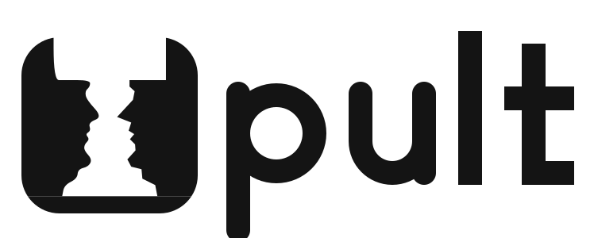
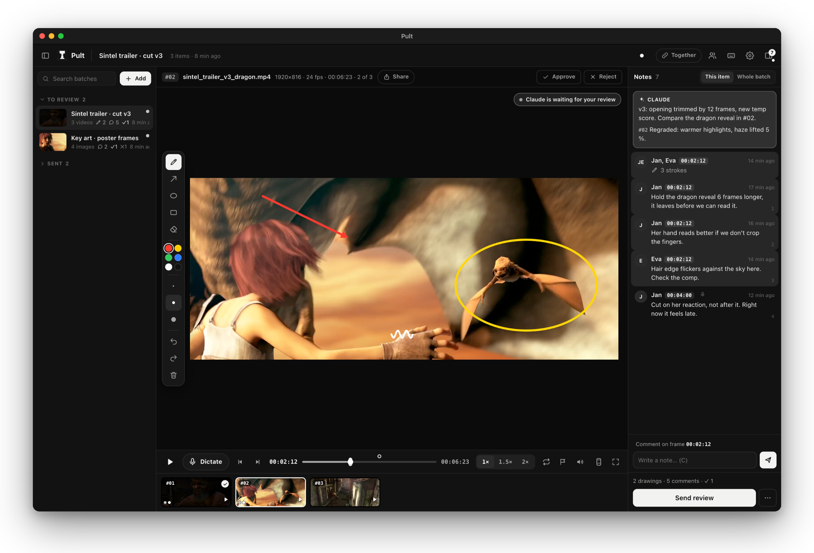

<p align="center"><picture><source media="(prefers-color-scheme: dark)" srcset="docs/logo-dark.svg"></picture></p>

# Pult

**Revize obrázků a videí pro práci s AI.** Tvůj AI agent (Claude Code, Codex) nebo kdokoli z týmu pošle na Pult obrázky a videa, ty je projdeš, kreslíš přímo do přesného snímku, píšeš komentáře, schvaluješ a zamítáš. Jedním tlačítkem pak revizi pošleš zpátky agentovi, který přesně ví, co a kde opravit.



<sub>Záběry: [Sintel](https://durian.blender.org) © Blender Foundation, CC BY 3.0.</sub>

Funguje na **macOS i Windows**, v prohlížeči nebo jako samostatná aplikace s ikonou. iPad s Apple Pencilem je bonus, ne podmínka.

## Instalace jedním promptem

Otevři Claude Code nebo Codex a vlož:

```
Nainstaluj mi Pult: https://github.com/jan-visual/pult (postupuj podle INSTALL.md)
```

Agent stáhne repozitář, doinstaluje Python a ffmpeg, nastaví spouštění po přihlášení a na Macu sestaví aplikaci Pult s ikonou v Docku.

Ručně: `git clone https://github.com/jan-visual/pult ~/pult-source && cd ~/pult-source && python3 install.py` (Windows `py install.py`; potřeba Python 3.9+ a pro videa ffmpeg).

Aktualizace: řekni agentovi „Aktualizuj Pult“ nebo spusť `pult update`. Knihovna a nastavení zůstanou. U starší verze Pultu místo toho vlož:

```
Aktualizuj Pult: https://github.com/jan-visual/pult (postupuj podle části „Updating“ v INSTALL.md)
```

*English: [README.md](README.md)*

## Jak se s Pultem pracuje

1. **Přidání:** řekni Claudovi „pošli to na Pult“, přetáhni soubory nebo celou složku do okna, nebo tlačítko **Přidat**. Volitelně složka **Vstup** (Nastavení › Knihovna): co do ní uložíš, objeví se na Pultu samo.
2. **Revize:** procházej položky (↑ ↓), přehrávej (mezerník) nebo jako ve střižně **J K L** (L zrychluje 1× → 1,5× → 2×, J pouští pozpátku, K zastaví), po snímcích čárka a tečka, o 5 vteřin šipky ← →, posouvej dvěma prsty po trackpadu. Kresli myší, perem nebo Apple Pencilem: pero, šipka, kroužek, obdélník. Komentář ke snímku napíšeš klávesou **C**.
3. **Diktování:** klávesa **D** (nebo mikrofon vedle přehrávání) zapne mikrofon. Pouštěj si video, zastavuj, mluv, kresli. Mikrofon zapneš jednou na celou revizi a mluvíš, kdy chceš: každá věta se sama přepíše do komentáře přesně k snímku, kde jsi ji začal říkat, i když video zrovna běží. Přepis dělá přímo tvůj počítač (Whisper nebo NVIDIA Parakeet, přepneš v Nastavení › Diktování). Nejlíp se sluchátky, ať mikrofon neslyší zvuk videa. Na iPadu diktování jde přes zabezpečenou adresu (návod v Nastavení › Diktování), zvuk z iPadu přepisuje počítač.
4. **Verdikt:** **S** schválit, **X** zamítnout (u variant: kterou chceš).
5. **Odeslat revizi** (⌘/Ctrl + Enter). Když dávku poslal Claude a svítí štítek **Claude čeká na tvoji revizi**, dorazí mu revize rovnou do chatu. Jinak ji uvidí, až mu řekneš „koukni na Pult“.

## Tým

Nastavení › Tým › **Sdílet v síti**: kolegové ve stejné síti otevřou odkaz s kódem a kreslí a komentují s tebou v reálném čase. Každý má svoje jméno a barvu, vidíte se navzájem (avatary nahoře, klik = skok tam, kde je kolega). Tlačítko **Spolu** sdílí přehrávání: kdo pustí nebo posune, tomu se ostatní přidají. Ideální na porady nad jedním videem.

## Užitečné

- **F**: celá obrazovka jen s obrazem (kino). **G**: bezpečné zóny Reels / TikTok / Shorts. **⌘/Ctrl + kolečko** nebo sevření prstů: přiblížení. **?**: všechny zkratky.
- Víc dávek najednou vybereš jako ve Finderu (⌘/Ctrl klik, ⇧ klik) a smažeš klávesou ⌫ (jde vrátit).
- Kresby se ukládají průběžně a vydrží i výpadek Wi-Fi; odešlou se, až bude spojení zpět.
- Pult nic natrvalo nemaže: smazané dávky jdou vrátit, staré odeslané se po čase přesunou do koše v knihovně.
- Videa si Pult převede na lehký náhled (plynulé přehrávání i na slabším počítači). Originály zůstávají beze změny.

## Pro Clauda

Agent (Claude Code, Codex) ovládá Pult příkazem `pult` (`add`, `status`, `reviews`, `archive`, `url`, `doctor`, `settings`). Revize leží v knihovně ve složce `revize/` jako `revize.md` a obrázky přesných snímků s kresbou.

## Když něco nefunguje

Pult je otevřený kód (Python a JavaScript, na Macu navíc malé okno ve Swiftu, které si instalátor sestaví sám). Stačí agentovi napsat, co nejde: přečte si log a kód a opraví to sám. Návod pro něj je ve skillu `pult`, část „Oprava Pultu“. Opravu můžeš poslat jako pull request na GitHub.

## Licence

MIT. Vytvořil [Jan Pils](https://janpils.com), střihač a tvůrce nástrojů z Prahy. Chceš, ať tvůj tým takhle pracuje s AI, nebo potřebuješ nástroj na míru? [Napiš mi](mailto:hello@janpils.com).
