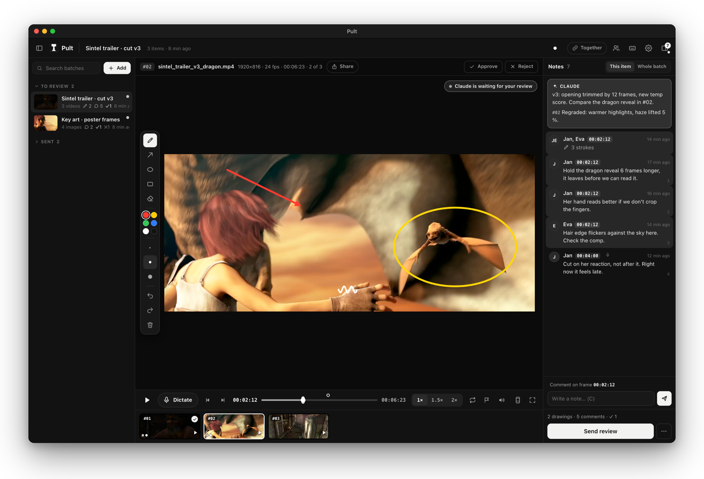

<p align="center"><picture><source media="(prefers-color-scheme: dark)" srcset="docs/logo-dark.svg"></picture></p>

# Pult

**Review images and videos with your AI agent.** Your AI agent (Claude Code, Codex) or anyone on your team sends images and videos to Pult. You go through them, draw right on the exact frame, comment, approve or reject. One click sends the review back to the agent, which knows exactly what to fix and where.

*Česky: [README.cs.md](README.cs.md)*



<sub>Footage: [Sintel](https://durian.blender.org) © Blender Foundation, CC BY 3.0.</sub>

Runs locally on **macOS and Windows**, in the browser or as a standalone app. iPad with Apple Pencil works great over your network.

## Install with one prompt

Open Claude Code or Codex and paste:

```
Install Pult for me: https://github.com/janpils/pult (follow INSTALL.md)
```

The agent clones the repo, installs Python and ffmpeg if needed, sets up Pult to start on login and on a Mac builds the Pult app with its own Dock icon.

Manual install: `git clone https://github.com/janpils/pult ~/pult-source && cd ~/pult-source && python3 install.py` (Windows PowerShell: `git clone https://github.com/janpils/pult "$HOME\pult-source"; cd "$HOME\pult-source"; py install.py`). Needs Python 3.9+ and ffmpeg for video.

To update, tell your agent "Update Pult" or run `pult update`. Your library and settings stay. On an older Pult paste this instead:

```
Update Pult: https://github.com/janpils/pult (follow "Updating" in INSTALL.md)
```

## What you can do

- **Draw on the exact frame:** pen, arrow, ellipse, rectangle, with mouse, pen tablet or Apple Pencil. Every stroke belongs to one precise frame.
- **Comment on a frame or the whole video**, approve (S) or reject (X) each item.
- **Dictate your notes:** press D, play the video and talk. Each sentence becomes a comment on the frame where you started saying it. Transcription via ElevenLabs Scribe (best quality, your own API key) or local Whisper (free, private).
- **Send the review to Claude:** when Claude sent the batch, the review lands straight in that chat. Pult then shows *Claude is working* with live progress and *Claude is done* when it's finished.
- **Play in sync across devices:** your Mac and iPad switch items together; *Together* mode syncs playback for the whole team, with an audio offset slider for AirPods.
- **Safe zones** for Instagram Reels, TikTok and YouTube Shorts (G).
- **AI metadata check:** Pult warns when a file carries C2PA / IPTC "AI generated" markers (Instagram and YouTube use them to label posts as AI) and makes a clean copy without them.
- **Team:** share on your network with an access code; everyone draws and comments live under their own name.
- Czech and English interface (Settings › Profile).

## How it works with your AI agent

The installer adds a `pult` command and a `pult` skill for Claude Code and Codex (plus a short block in `CLAUDE.md` / `AGENTS.md`). The agent uses:

| Command | What it does |
|---|---|
| `pult add -t "title" -m "what to check" files…` | new batch for review |
| `pult wait <id>` | waits in the background; the review arrives in the same chat |
| `pult progress <id> "what I'm doing"` | shows progress in Pult |
| `pult archive <review folder> -m "what's done"` | marks the review as done |
| `pult status` | new reviews |

Reviews are saved as `revize.md` plus images of the exact frames with your drawings, so the agent sees exactly what you marked. Also `pult note` (update your note in Pult), `pult reviews` and `pult doctor` (check the install).

## Privacy

Everything runs on your computer. Nothing is uploaded anywhere, except dictation audio when you choose ElevenLabs. Your API key stays in a local file readable only by your account.

## License

MIT. Made by [Jan Pils](https://janpils.com), video editor and tool builder from Prague. Want your team to work with AI like this, or need a custom tool? [Email me](mailto:hello@janpils.com).
